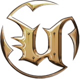

<div align="center">



# Unreal Tournament '99 — Discord Rich Presence

**Bring the arena to your Discord profile.**

A community-made companion for **Unreal Tournament (1999)** with live match information, map artwork, campaign progress, and character portraits.

   

**[Installation](#installation) · [Campaign setup](#single-player-tournament-campaign) · [Troubleshooting](#troubleshooting)**

</div>

> [!NOTE]
> Unofficial fan project. Not affiliated with Epic Games, OldUnreal, or Discord. Tested by the project creator with UT99 v469f Preview; other builds may work but have not been verified.

## Highlights

| Feature | What appears on Discord |
| --- | --- |
| **Automatic connection** | Uses the project's shared Discord application — no developer account or manual Application ID needed |
| **Map artwork** | Artwork for 69 classic Deathmatch, CTF, Domination and Assault maps |
| **Game modes** | Deathmatch, Team Deathmatch, Last Man Standing, CTF, Domination, Assault, Monster Hunt, BunnyTrack, Rocket Arena UT and more |
| **Live match information** | Frags, deaths, player/bot counts and game-mode limits where reported by the bridge |
| **Tournament campaign** | Character creation/continue screens, tutorials, stage progress and selected save-slot difficulty |
| **Character portrait** | Selected `User.ini` face as a small Discord image when that asset is available |
| **Timers** | Continuous Discord session timer; separate match timer resets for new matches |
| **Main menu** | Animated UT99 artwork while not in a match |

The companion talks to the UT99 UnrealScript bridge over **local-only UDP** (`127.0.0.1:29777`). No hosted gameplay service or bot token is needed.

## Requirements

- Windows 10 or 11
- Unreal Tournament 1999 (tested on **v469f Preview**)
- Desktop Discord running and signed in
- Python 3 installed, including the Windows `py` launcher
- Internet access on first launch to install Python dependencies

## Installation

### 1. Start the companion

1. Download and extract the repository ZIP, or clone the repository.
2. Run **`start.bat`**. It creates a virtual environment and installs `pypresence` and `psutil`.
3. Open desktop Discord, then launch UT99.
4. Leave the companion window open while playing.

**Discord connects automatically** using public Application ID `1560958602464854036`. You do **not** need to create your own Discord application. To use a different app, place its public ID in `discord_app_id.txt` beside the Python script; that app must have matching Rich Presence assets.

> [!TIP]
> At this point the companion can show the main menu and session timer. **To show maps, game modes and stats, install the bridge below.**

### 2. Install the UT99Presence bridge

1. Copy the **`UT99Presence/`** folder to your UT99 installation root (next to the `System/` directory).
2. Copy **`UT99Presence.int`** into UT99's `System/` directory.
3. Open `System/UnrealTournament.ini`. Under `[Editor.EditorEngine]`, add `EditPackages=UT99Presence` if it is not already listed.
4. Open a command prompt in UT99's `System/` directory and run:

   ```bat
   ucc.exe make
   ```

   If replacing an older version, back up and remove the old `System/UT99Presence.u` before recompiling.
5. Launch UT99 and select **UT99 Discord Presence** in **Practice Session → Mutators**.
6. Enter a match and look for `Bridge:` and `IMAGE DEBUG:` messages in the companion console.

The bridge sends status updates to `127.0.0.1:29777`. **Do not forward or expose this port publicly.**

## Single-player Tournament campaign

Tournament mode does not ordinarily carry Practice Session mutators into ladder matches. The optional third-party **MutatorsLoader** can apply the selected **Always use** mutators to the campaign.

1. First install and compile the UT99Presence bridge above, and confirm it works in a Practice Session.
2. Copy `MutatorsLoader.u`, `MutatorsLoader.ini`, and `MutatorsLoader.int` from `third_party/MutatorsLoader/` into UT99's `System/` folder.
3. In **Practice Session → Mutators**, select **UT99 Discord Presence** and enable **Always use** for the selected mutator list. Start a practice match once to save the selection.
4. In UT99's **Mod** menu, choose **Use MutatorsLoader everywhere**.
5. Start or continue the **Single Player / Tournament** ladder. The companion should now receive `Bridge:` messages from campaign maps.
6. Re-enable MutatorsLoader from the **Mod** menu after each fresh UT99 launch before campaign play.

> [!WARNING]
> The original MutatorsLoader instructions warn that activating it before joining **ACE-protected multiplayer servers** may cause a kick. Restart UT99 before joining such servers. MutatorsLoader is not intended to inject mutators into remote servers.

**Campaign difficulty:** `campaign_save_slot.txt` contains a slot number from `1` to `5` (default `1`). The companion reads the matching `[UTMenu.SlotWindow]` save from the running game's `System/User.ini`. Active save-slot detection is **manual**, not automatic. If needed, set the full `User.ini` path in a separate `ut99_user_ini_path.txt` beside the script.

**Reset:** Use **Mod → Reset Discord Presence** to clear campaign tracking without restarting the Discord session timer.

### Third-party distribution notice

MutatorsLoader is a separate project and **not covered by this repository's MIT license**. Its supplied files do not establish redistribution permission. **Before publishing this repository publicly, obtain permission to redistribute the loader binary or remove `third_party/MutatorsLoader/` and link to an authorized source instead.** See its original `MutatorsLoader.txt` for instructions.

## Character portraits and map assets

- Map artwork remains the **large** Discord image.
- The selected character face is read from `System/User.ini` → `[DefaultPlayer]` → `Face=` and becomes the **small** image when a matching asset key is registered.
- Currently configured face: `CommandoSkins.Grail` → `face-commandoskins-grail`.
- Additional portraits must be uploaded to the relevant Discord application's assets and added to `FACE_ASSET_KEYS` in `ut99_presence.py`.
- Special map keys: `DM-Deck16` → `deck16-fixed`, `CTF-Face][` → `ctf-face2`.
- Asset updates on Discord may take time to propagate.

## Troubleshooting

| Problem | Check |
| --- | --- |
| `WinError 10048` | Another companion is already listening on UDP port `29777`; close the older instance. |
| Discord presence missing | Ensure desktop Discord is running; check any custom `discord_app_id.txt` override. |
| No map or score updates | Check that `UT99Presence.u` compiled and the mutator is enabled; look for `Bridge:` messages. |
| Map image shows the UT99 logo | Compare `IMAGE DEBUG` asset keys against those uploaded to the selected Discord application; allow for caching. |
| Face portrait missing | Check `[DefaultPlayer] Face=` in `User.ini`, `FACE DEBUG`, and `FACE_ASSET_KEYS`. |
| Incorrect campaign difficulty | Confirm the slot number in `campaign_save_slot.txt` and the `User.ini` path shown in the console. |
| `ucc make` fails | Verify `EditPackages=UT99Presence`, source folder placement, and any old compiled `.u` file. |

## Project structure

```text
UT99Presence/Classes/       UnrealScript bridge, mutator and reset menu
third_party/MutatorsLoader/  Optional third-party campaign loader (license separate)
assets/                      Repository icon
ut99_presence.py             Python companion
start.bat                    Windows launcher
requirements.txt             Python dependencies
campaign_save_slot.txt       Selected campaign save slot
UT99Presence.int             UT99 registration file
LICENSE                      License for original project code
```

## Credits and license

**Created by Luggworm.** Built for the Unreal Tournament community.

Original project code is provided under the [MIT License](LICENSE). MutatorsLoader, Unreal Tournament, Discord, and all third-party artwork remain under their respective owners' rights. This repository is an unofficial community project.
